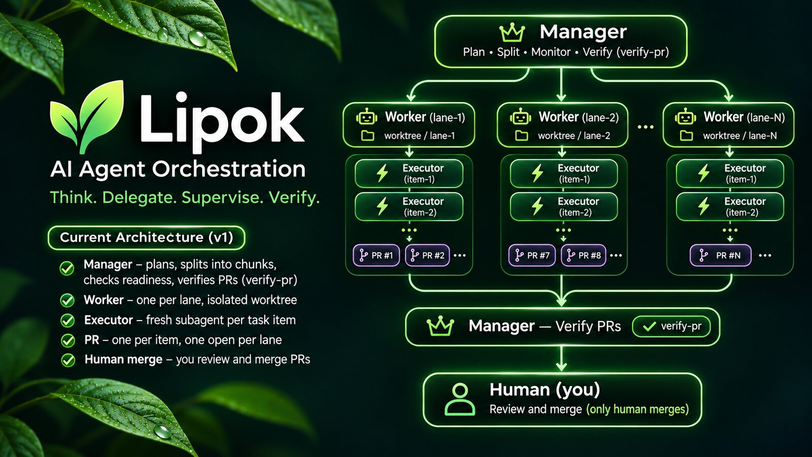

# Lipok 🍃



**A multi-agent development harness for Claude Code.** Give it a plan or a task; a Manager session
splits it into chunks that never touch the same files, runs each chunk in its own git worktree
with a worker session, and brings you only what needs a human: the cut to approve, decisions to
answer, and pull requests to merge. Nothing is merged without you.

> **Status — 1.0.0.** One lane is proven on a real project (a chunk of six pull requests, all
> merged by hand). Several lanes in parallel are implemented and tested, but have not run on a real
> project yet. Developed on Windows with Git Bash; macOS and Linux are untested.

Lipok is a set of Claude Code skills plus a few scripts. There is no server and no daemon: sessions
talk to each other with one-line messages, and the state lives in plain files under `~/.lipok`.

## Requirements

- The **Claude Code desktop app** — the Manager starts worker sessions and messages them, which the
  CLI alone cannot do.
- A project that is a **GitHub repository**, with the GitHub CLI `gh` installed and signed in.
- `git`, Python 3.10+ (`python`, or `python3` where there is no `python`), and bash (Git Bash on
  Windows).
- Node.js 18+, for the installer only.
- Optional: the `plan-status` skill, so that "status" shows the plan's position.

## Install

```bash
npx github:DemchaAV/Lipok install
```

It checks the requirements above, then copies the `lipok` and `lipok-task` skills into
`~/.claude/skills`, replacing only those two folders. Run the same command again to update.
While the repository is private, npm fetches it with your git credentials; if it cannot, run
`gh auth setup-git` once.

```bash
npx github:DemchaAV/Lipok doctor
```

```bash
npx github:DemchaAV/Lipok uninstall
```

`doctor` only checks. `uninstall` removes the two skill folders and keeps `~/.lipok`. From a clone,
`bash install.sh` does the same copy without Node. To install elsewhere, pass `--dir <folder>` or
set `CLAUDE_SKILLS_DIR`.

**Check it worked:** open any project in the Claude Code app and type `/lipok-task`. With no task
yet, it answers that there is none and how to start one.

## Use

In the project's folder, in the Claude Code app:

```text
/lipok-task docs/plans/my-plan.md        a plan with a "## Progress" checklist
/lipok-task add CSV export to reports    free text: the Manager drafts the plan first
/lipok-task                              the active task's status, or resume after a restart
/lipok-task status | pause | resume | stop    control the active task
/lipok-task profile                      show or change the project profile
```

1. **First run in a project:** the Manager drafts the project profile
   (`~/.lipok/projects/<owner>-<repo>/project.json`: the gate command, base branch, commit author,
   required CI checks, `max_lanes`, …) and writes it after your "yes". Fields:
   [`project-profile.md`](skills/lipok/references/project-profile.md); change them later with
   `/lipok-task profile`.
2. **The cut and the lanes:** the Manager shows the chunks, their waves and file areas, and what
   each number of lanes buys — for example *1 lane: 7 rounds · 3 lanes: 4 rounds · 5 lanes: 3
   rounds (fastest)*. You pick the number; the workers start after your "yes". More lanes finish
   sooner and spend about the same tokens in total, but use your plan's limit faster and bring more
   pull requests for you to merge at once.
3. **While it runs:** approve chunk plans when asked, answer decisions, merge the pull requests it
   calls ready. In the Manager's session you can say "status", "merged", "pause", "resume",
   "stop task" or "profile" — in any language.

Everything a task keeps is under `~/.lipok`: project profiles, task state, briefs, reports,
decisions and machine-wide locks. It is safe to delete when no task is active.

## How it works

```text
you ── /lipok-task <plan> ──► Manager (the session you talk to)
                                │  cuts the task into chunks, checks the cut (cut-check)
                                │  starts one worker session per lane
                ┌───────────────┼───────────────┐
             worker 1        worker 2        worker 3     each in its own git worktree
                │                │                │
         an executor per item (a fresh subagent: change → test → review → pull request)
                │
         READY ──► the Manager verifies the PR against GitHub (verify-pr) ──► you merge
```

- **Manager** — the task's interface. Cuts the task, checks each chunk plan against the whole
  picture, corrects course, verifies what a worker calls ready, carries decisions to you, keeps the
  merge queue, and watches that every worker is alive and moving. It never writes code and never
  reads diffs or CI logs, only plans, notes and script verdicts.
- **Worker** — leads one chunk in its own worktree: writes the chunk plan, gives every item to a
  fresh executor, checks the report, runs the gate, watches CI and the merge.
- **Executor** — one item, one fresh context, one pull request.

### No collisions between lanes

- Chunks run in **waves**. Two chunks of one wave never change the same file. Files every part
  needs (router, registries, lockfiles, migrations, `CHANGELOG`) have one owner: a **contract**
  chunk before the wave or an **assembly** chunk after it.
- `lipok.py cut-check` refuses a cut where two parallel chunks may touch one file, checked against
  the repository's files and against each other's globs, and prints how many lanes it can use.
- `lipok.py verify-pr` refuses a PR that is a draft, conflicts with the base, has changes requested,
  red or missing required CI checks, unresolved review threads, a stale gate run, or a file outside
  its chunk's area.
- After a merge, a lane whose open PR overlaps the merged files gets a `SYNC` (merge, never rebase
  or force-push). Shared machine resources (a database, an emulator) are taken through locks.

### Supervision

Background scripts cost nothing while they wait and end with one line that wakes their session:

| Script | Run by | Fires on |
|---|---|---|
| `wait-pr.sh` | the worker | `MERGED`, `CLOSED`, `CI-GREEN`, `CI-FAIL`, `CI-MISSING` (a required check never started) |
| `watch-session.sh` | the Manager | a worker's turn died, went quiet, hit the usage limit, or vanished |
| `lipok.py stall-check --watch` | the Manager | no progress for too long, or an item looping past its attempts |

### Only the human merges

Lipok opens pull requests and never merges them: no auto-merge, no force-push, no pushes to the
base branch. Commits carry the project's author, with no assistant attribution.

### Cost

The executors do most of the work and spend most of the tokens; on the single-lane pilot the
Manager and the worker's own turns took about 15%. `lipok.py usage` prints this split for any task,
read from the transcripts on disk.

The full design: [docs/architecture.md](docs/architecture.md).

## Layout

```text
skills/lipok/                    the core: SKILL.md, a reference per role, scripts
  references/manager.md          the Manager
  references/decomposition.md    the cut into parallel chunks
  references/lane.md             the Manager's side of a lane: briefs, lines, supervision
  references/worker.md           the worker
  references/item.md             the executor
  references/project-profile.md  the project profile's fields
  scripts/lipok.py               state, keys, verify-pr, stall-check, cut-check, usage, locks
  scripts/wait-pr.sh             the PR and CI watch
  scripts/watch-session.sh       the worker liveness watch
  scripts/crlf-replace.py        exact edits to files with CRLF line ends
skills/lipok-task/               the /lipok-task command
bin/lipok.js, install.sh         installers
tests/run.sh                     script tests
docs/architecture.md             how Lipok works
docs/design-history.md           how it got there
```

## Contributing

See [CONTRIBUTING.md](CONTRIBUTING.md). Changes: [CHANGELOG.md](CHANGELOG.md).

## License

[MIT](LICENSE).

Lipok was called Archon until 2026-11-15.
