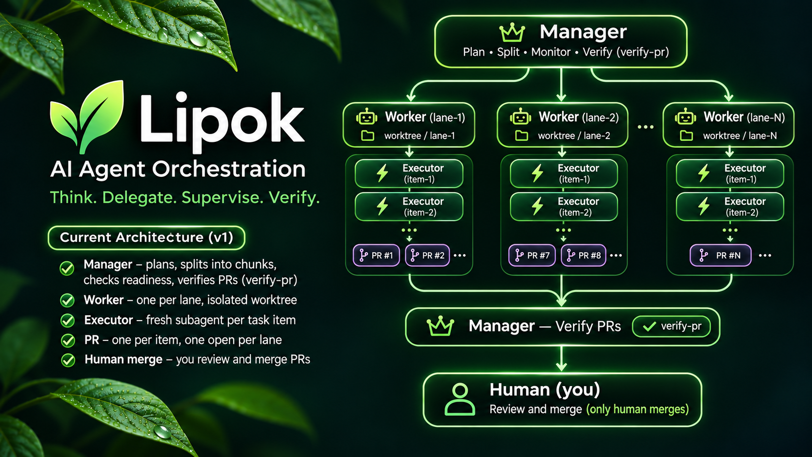

# Lipok 🍃



A multi-agent development harness for Claude Code. You give it a task or a plan; a **Manager**
session cuts it into chunks that never touch the same files, starts **worker** sessions that each
build one chunk in their own git worktree, and brings you only what needs a human: the cut to
approve, decisions to answer, and pull requests to merge.

Lipok is a set of Claude Code skills plus a few scripts. There is no server and no daemon: the
sessions talk to each other with one-line messages, and the state lives in plain files under
`~/.lipok`.

## How it works

```text
you ── /lipok-task <plan> ──► Manager (the session you talk to)
                                │  cuts the task into chunks, checks the cut (cut-check)
                                │  starts one worker session per lane
                ┌───────────────┼───────────────┐
             worker 1        worker 2        worker 3     each in its own worktree
                │                │                │
         executor per item  (a fresh subagent: measure → change → test → review → PR)
                │
         READY ──► Manager verifies the PR against GitHub (verify-pr) ──► you merge
```

- **Manager** — the task's interface. Cuts the task, checks each worker's chunk plan against the
  whole picture, corrects course, verifies what a worker calls ready, carries decisions to you,
  keeps the merge queue, and watches that every worker is alive and moving. It never writes code
  and never reads diffs or CI logs — only plans, notes and script verdicts.
- **Worker** — leads one chunk in its own worktree. Writes the chunk plan, gives every item to a
  fresh executor subagent, checks the report, runs the gate, watches CI and the merge.
- **Executor** — one item, one fresh context, one pull request.

### No collisions between lanes

- The cut runs chunks in **waves**. Two chunks of the same wave never change one file; files every
  part needs (router, registries, lockfiles, migrations, `CHANGELOG`) have one owner — a
  **contract** chunk before the wave or an **assembly** chunk after it.
- `lipok.py cut-check` refuses a cut where two parallel chunks may touch the same file, checked
  against the repository's real file list and against each other's globs. It prints how many
  lanes the cut can use, capped by the project's `max_lanes`.
- `lipok.py verify-pr` refuses a PR that changes a file outside its chunk's area, a draft, red or
  missing required CI checks, unresolved review threads, a stale gate run.
- After a merge, a lane whose open PR overlaps the merged files gets a `SYNC` (merge, never rebase
  or force-push). Shared machine resources (a database, an emulator) are taken through locks.

### Supervision

Background scripts cost nothing while they wait and wake the Manager with one line:

| Script | Fires on |
|---|---|
| `wait-pr.sh` | `MERGED`, `CLOSED`, `CI-GREEN`, `CI-FAIL`, `CI-MISSING` (a required check never started) |
| `watch-session.sh` | a worker's turn died (`SESSION ERROR`), went quiet, hit the usage limit, or vanished |
| `lipok.py stall-check --watch` | no progress for too long, or an item looping past its attempts |

### Only the human merges

Lipok opens pull requests and never merges them. No auto-merge, no force-push, no pushes to the
base branch; commits carry the project's author, with no assistant attribution.

## Requirements

- The Claude Code desktop app (the Manager starts worker sessions and messages them).
- `git`, the GitHub CLI `gh` (signed in), Python 3.10+, and a bash. Developed on Windows with Git
  Bash; macOS and Linux are untested.
- Node.js 18+ for the installer.

## Install

```bash
npx github:DemchaAV/Lipok install
```

It checks git, gh (and that it is signed in), Python and bash, then copies `skills/lipok` and
`skills/lipok-task` into `~/.claude/skills`, replacing only those two folders. Run the same command
again to update. The repository is private: npm fetches it with your git credentials — if it
cannot, run `gh auth setup-git` once.

```bash
npx github:DemchaAV/Lipok doctor
```

```bash
npx github:DemchaAV/Lipok uninstall
```

`doctor` only checks; `uninstall` removes the two skill folders and keeps task state in `~/.lipok`.
From a clone, `bash install.sh` copies the skills without Node.

## Use

In the project's folder, in the Claude Code app:

```text
/lipok-task docs/plans/my-plan.md        a plan with a progress checklist
/lipok-task add CSV export to reports    free text — the Manager drafts the plan first
/lipok-task                              the active task's status, or resume after a restart
```

The first run in a project writes its profile, `~/.lipok/projects/<owner>-<repo>/project.json`
(the gate command, base branch, author, `required_checks`, `max_lanes`, `max_ready_prs` …) —
see `skills/lipok/references/project-profile.md`.

In the Manager's session: «статус» (status), «влил» (I merged), «пауза» (pause), «продолжай»
(resume), «стоп задачи» (stop the task).

At the end of a task, `lipok.py usage` splits the tokens it spent between the Manager, the
workers and the executors — read from the transcripts on disk, no model call.

## Layout

```text
skills/lipok/              the core: SKILL.md, references per role, scripts
  references/manager.md    the Manager
  references/decomposition.md  the cut into parallel chunks
  references/lane.md       the Manager's side of a lane: briefs, lines, supervision
  references/worker.md     the worker
  references/item.md       the executor
  scripts/lipok.py         state, keys, verify-pr, stall-check, cut-check, usage, locks
  scripts/wait-pr.sh       the PR and CI watch
  scripts/watch-session.sh the worker liveness watch
bin/lipok.js               the installer (npx … install / doctor / uninstall)
skills/lipok-task/         the /lipok-task command
tests/run.sh               the script tests: bash tests/run.sh skills/lipok/scripts/lipok.py <tmp dir>
docs/architecture.md       the design (v6, in Russian)
```

## Status

First release (internal design generation v6). A full single-lane pilot ran on a real project: one chunk, six pull requests, all merged by
hand, decisions relayed, a production defect turned into a new item before the chunk closed. On
that pilot coordination (Manager plus the worker's own turns) took about 15% of the tokens, the
executors 85%. The multi-lane cut (`decomposition.md`, `cut-check`) is implemented and tested but
has not run live yet.

Lipok was called Archon until 2026-11-15.
